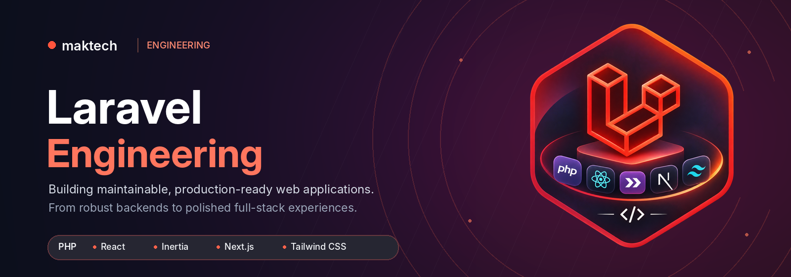
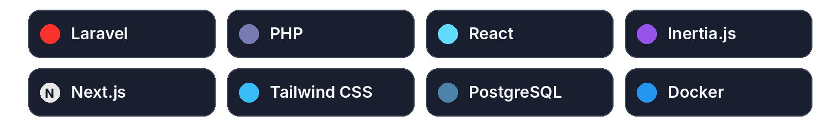

# maktech · Laravel Engineering

**Modern Laravel applications. Thoughtful architecture. Better developer experiences.**

We are the **Laravel engineering team at maktech**, building maintainable web applications, APIs, business platforms, and full-stack products with a Laravel-first mindset.

[**Explore repositories**](https://github.com/mak-laravel-git?tab=repositories) · [**GitHub profile**](https://github.com/mak-laravel-git)

---

### Our technology stack

  

**Core:** Laravel · PHP · Inertia.js · React · Tailwind CSS  
**Additional frontend:** Next.js · TypeScript · JavaScript  
**Data & infrastructure:** PostgreSQL · MySQL · Docker · GitHub Actions

### What we build

| Area | Our focus |
| --- | --- |
| **Laravel applications** | Custom business software, dashboards, portals, and workflow-driven platforms. |
| **Backend engineering** | REST APIs, authentication, authorization, integrations, queues, and maintainable data models. |
| **Full-stack development** | Responsive products with Laravel, Inertia, React, and Tailwind CSS. |
| **Modern frontends** | Interactive React and Next.js experiences when the project calls for them. |
| **Delivery & operations** | Testing, Git workflows, deployment automation, and production maintenance. |

### How we approach engineering

- **Clarity first** — readable code, clear boundaries, and pragmatic architecture.
- **Secure by design** — thoughtful access control, input validation, and careful handling of secrets.
- **Built to evolve** — maintainable components, APIs, and database schemas.
- **Quality matters** — testing, code reviews, and predictable deployment practices.
- **Team collaboration** — shared conventions and reliable developer workflows.

### About this GitHub account

This profile represents **maktech's Laravel team**. Our repositories support development, collaboration, reusable engineering practices, and team tooling.

Some client and internal projects are intentionally **private**. Public repositories, when available, can be explored through the link below.

**Laravel at the core. Built by maktech.**

[View public repositories](https://github.com/mak-laravel-git?tab=repositories)

